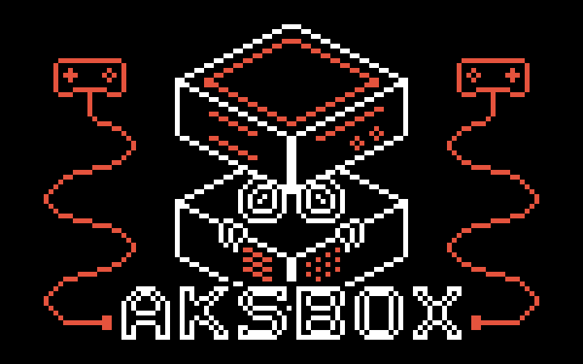

# 

A handheld game console built from scratch around an ESP32-S3, programmed in C with ESP-IDF and FreeRTOS. The display driver, input handling, graphics, audio synthesis and game engine are written for this project; no Arduino layer or graphics library.

<!--  -->

## Status

Work in progress. The hardware is a breadboard prototype, and firmware development started in October 2026.

## Features

Planned:

- ILI9341 display driver over SPI with pipelined DMA transfers and a double-buffered framebuffer in PSRAM
- Interrupt-driven, debounced input for 8 buttons
- Four-voice synthesizer (pulse, triangle and noise channels with envelopes) over I2S
- Launcher listing every game in the library, with pause menu and settings
- Game library on an internal microSD card; settings and high scores in on-chip NVS
- Game cartridges: play a game directly from a cartridge, or install it to the microSD library

## Hardware

| Component | Part |
|---|---|
| Microcontroller | ESP32-S3-DevKitC-1-N32R16V (32 MB flash, 16 MB PSRAM) |
| Display | Adafruit 2.8" 320×240 TFT, ILI9341 controller (prototype; touch unused) |
| Storage | microSD slot on the display breakout |
| Audio | MAX98357A I2S class-D amplifier, 4 Ω speaker |
| Controls | 8 tactile buttons (D-pad and A/B/X/Y), power switch |

## Project structure

| Path | Contents |
|---|---|
| `components/aks_engine` | Shared engine: display, graphics, input and audio |
| `launcher` | The launcher that lists and starts games |
| `games/snake` | Snake |

## Prerequisites

- ESP-IDF v6.x, installed with the ESP-IDF Installation Manager (EIM)
- The hardware above, wired as described in the pin map (coming with the hardware documentation)

## Build and flash

Activate ESP-IDF in your shell, then:

```bash
idf.py set-target esp32s3
idf.py -p /dev/ttyACM0 build flash monitor
```

Use the board's port labelled **USB**. Exit the monitor with `Ctrl+]`.

## Learning labs

The concepts behind AksBox were learned and tested first as small standalone experiments in [esp32-embedded-labs](https://github.com/AkseliHyv/esp32-embedded-labs): GPIO and debouncing, FreeRTOS, interrupts, SPI, I2C, I2S, DMA, hardware pulse counting and bare-metal ARM on an STM32. Each lab documents its wiring, approach and measured results.
